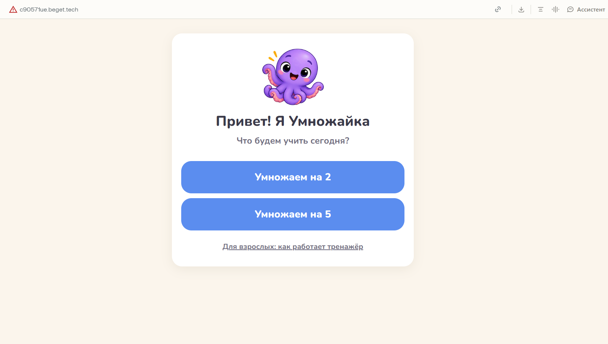
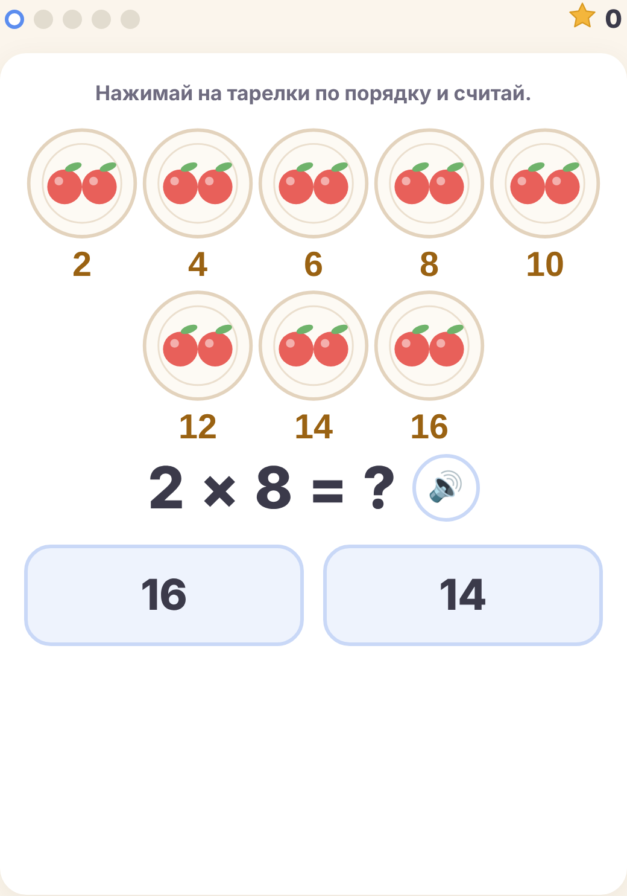
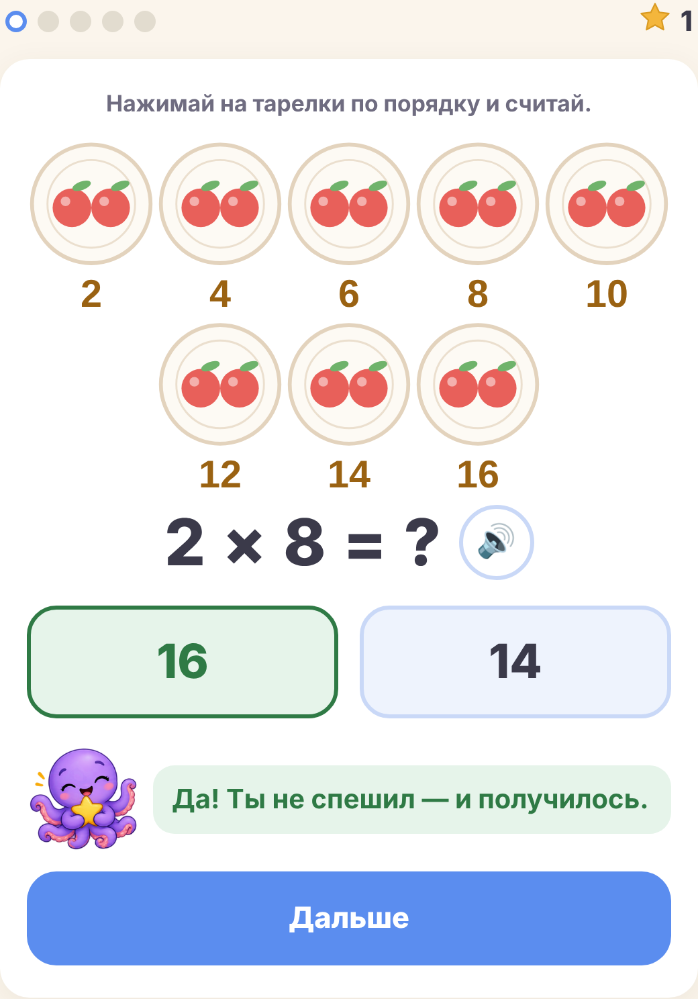

# Умножайка

Тренажёр таблицы умножения для детей, в том числе для детей с ОВЗ. Ребёнок учит умножение не зубрёжкой, а через картинки: сначала считает предметы, потом точки, потом идёт по числовому лучу. Рядом всегда осьминожка Умножайка, которая подсказывает и радуется вместе с ребёнком.

**Попробовать:** http://c90571ue.beget.tech



## Для кого

- **Дети 7–10 лет**, которым трудно даётся таблица умножения, в том числе дети с ОВЗ.
- **Родители**, которые хотят заниматься с ребёнком дома без слёз и зубрёжки.
- **Специалисты**: нейропсихологи, дефектологи, репетиторы начальной школы.

## Что умеет

- Столбики **×2 и ×5**.
- **Три ступеньки картинок**: тарелки с предметами → точки столбиками со скобками → числовой луч. Ребёнок переходит на следующую ступеньку после двух уверенных ответов и возвращается на шаг назад, если понадобилась подсказка.
- **Счёт нажатием по группам**: ребёнок сам отсчитывает группы, а не угадывает ответ.
- **Озвучка** 🔊 заданий голосом браузера.
- **Осьминожка Умножайка** с 12 эмоциями реагирует на ответы.
- **Физминутка** между заданиями.
- **Экран «Для взрослых»**: как устроен тренажёр и как с ним заниматься.

| Ребёнок считает тарелки группами | Умножайка радуется правильному ответу |
|---|---|
|  |  |

## Как запустить

Тренажёр — это один файл `index.html`, все картинки встроены в него. Ничего устанавливать не нужно.

- **Онлайн:** откройте http://c90571ue.beget.tech
- **Локально:** скачайте `index.html` и откройте его двойным кликом в любом браузере.

## Как сделан

- Чистый HTML, CSS и JavaScript в одном файле, без сервера и базы данных.
- Сделан с помощью Claude Code (модель gpt-oss через Ollama) в рамках курса по Claude Code.
- Опубликован на хостинге Beget: открывается в России без VPN.

## Структура репозитория

```
index.html                         — сам тренажёр
screenshots/                       — скриншоты для README
.claude/skills/umnozhaika-dev/     — скилл для доработки тренажёра в Claude Code
```

## Скилл для Claude Code

В папке `.claude/skills/umnozhaika-dev/` лежит скилл `umnozhaika-dev`. Он объясняет агенту, как устроен тренажёр и по каким правилам его дорабатывать: как добавить новый столбик, не сломав методику ступенек, как проверить изменения и как выложить новую версию на хостинг.

Чтобы использовать скилл, склонируйте репозиторий, запустите Claude Code в его папке и напишите, например:

```
/umnozhaika-dev добавь столбик ×9
```

## Что дальше

1. Правки по отзыву нейропсихолога и тест на детях.
2. Новые столбики по порядку: ×9, ×4, ×3 и дальше.
3. Свой домен и https.
4. Аккаунты, сохранение прогресса и отчёт для родителя и специалиста.
5. Мини-приложения в Telegram и ВКонтакте, которые открывают тот же сайт.
